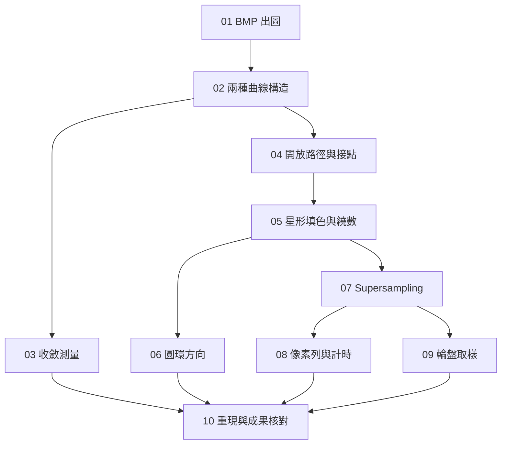

# 前三題與共用工具庫：可稽核檢查點

狀態：使用者已核准實作；01–10 的驗收條件均已通過。正式本地票、實際測試與工件見下方連結及 [稽核記錄](audit.md)。程式審查另見 [review.md](review.md)。

依據：[規格](spec.md)、[已確認設計](design.md)、[術語](../GLOSSARY.md)。

## 切分原則

- 每個檢查點都有可執行、可展示或可獨立驗證的結果，並包含該結果所需的程式與測試。
- 不將數學、影像、測試各自拆成只完成單一層的票；以具體使用情境逐步增加能力。
- 只列出真正阻擋開工的前置票；可由其他阻擋票推導的相依不重複列出。
- 現有工作區沒有程式碼，沒有需要先處理的既有重構。01 同時建立可執行的 Rust 專案起點。
- 每票以一個全新工作上下文能完成為尺度；跨題的最終核對集中於 10。
- 驗收框依實際測試、獨立稽核、圖像人工確認與報告核對勾選；結果可在稽核記錄及本地票追溯。

## 共通稽核門檻

每個檢查點完成時，應留下以下證據，缺一項就不能只以「程式寫完」宣告完成：

1. 程式版本或可識別的變更版本，以及建置／執行指令。
2. 必要的環境、輸入資料及參數；圖形應包含控制點、畫布與方向等重現資訊。
3. 已實際執行的相關測試摘要，包含結果與使用的浮點容差。
4. 該票列出的輸出工件及其對應數據；需要人工判斷的圖附確認記錄。
5. 題目要求與成果的對應，以及未完成項目。不得把尚未執行的數值或結論當成證據。

既有公開介面的有效行為應維持；每票加入的無效輸入處理由該票驗證，不另設一張最後才補錯誤處理的票。

## 任務總覽

| 票號 | 標題 | Blocked by | 可稽核交付 |
| --- | --- | --- | --- |
| 01 | 一次執行產生可正確解碼的 BMP | 無 | 彩色測試圖、獨立解碼結果、可執行 Rust 起點 |
| 02 | 同一條 Bézier 的兩種構造可比較 | 01 | 自製曲線座標、淺層折線疊圖、數學與構造測試 |
| 03 | 曲線誤差與收斂可重現 | 02 | 間距檢查、深度／誤差資料、門檻深度與回答 |
| 04 | 三段開放路徑的接點可比較 | 02 | 平滑／角點、等長／不等長版本及接點回答 |
| 05 | 自交星形可填色並查詢繞數 | 04 | 五頂點星形 BMP、中心繞數、scanline 邊界驗證 |
| 06 | 只反轉內圈就能比較圓環填色 | 05 | 兩張圓環、中心繞數、位置不變證據及字型回答 |
| 07 | 同一旋轉星形可做四種 supersampling | 05 | k 為 1、2、4、8 的圖與覆蓋率、區塊平均測試 |
| 08 | 星形像素列與渲染成本可量測 | 07 | 合格取樣區段、數值曲線、各 k 的計時表與回答 |
| 09 | 輪盤中心的取樣限制可觀察 | 07 | 至少 40 楔形的 k 為 1／8 比較及理論回答 |
| 10 | 前三題成果可整批重現與追溯 | 03、06、08、09 | 重現流程、完整成果清單與前三題報告材料 |

## 阻擋關係

實作依此相依順序完成；圖中表示需求依賴，不表示使用外部任務或並行實作。

## 01：一次執行產生可正確解碼的 BMP

**What to build：** 使用者可建置並執行 Rust 示範，從一般 Image 資料與浮點 Color 產生 BMP，並由工具庫以外的解碼器確認圖像正確。

**Blocked by：** 無，可以立即開始。

**需求對應：** 共用工具庫的 Image、Color、BMP、具體錯誤及建置／執行說明；作業通用可重現要求。

- [x] 建立可建置、可測試、可執行示範的 Rust 專案起點；使用者可依說明完成一次出圖。
- [x] 同一套 Image 儲存與像素／列存取能支援 f64 數值影像及 Color 影像，並可經像素轉換產生彩色結果。
- [x] 浮點 RGB 混色及輸出量化符合已確認規格；存檔前才轉成 8-bit 通道。
- [x] 自製未壓縮 24-bit BMP 正確處理 little-endian 標頭、BGR、bottom-up、列補齊、像素偏移及檔案大小。
- [x] 使用有列補齊且上下左右顏色不同的測試圖，由獨立解碼器確認尺寸、通道與列方向。
- [x] 驗證越界查詢、零尺寸、尺寸溢位、非有限顏色值與 I/O 失敗的對外行為。

**稽核證據：** 示範 BMP、預期像素配置、獨立解碼後的核對結果、相關測試摘要與建置／執行記錄。

## 02：同一條 Bézier 的兩種構造可比較

**What to build：** 使用者提供四個控制點，能取得自製矩陣公式與中點細分的結果，並顯示淺層折線與曲線的差異。

**Blocked by：** 01：沿用其 Rust 專案、執行方式、影像／輸出與共用錯誤基礎。

**需求對應：** P1-1；固定尺寸 Matrix、Vector、Point2、CubicBezier 及點到線段距離介面。

- [x] 使用 f64 與固定尺寸陣列；矩陣乘法結果尺寸正確，不相容尺寸的使用無法編譯。
- [x] 向量共用直欄矩陣表示；點與位移的加減結果型別、內積、長度、轉置及單位矩陣符合設計。
- [x] 曲線公式座標由自製矩陣計算；中點細分獨立實作，深度 0 為兩端點，深度 d 產生相應數目的線段。
- [x] 使用明顯彎曲且跨越大部分畫布的控制點，輸出可見差異的淺層疊圖與兩組原始座標。
- [x] 呈現第一題結果時只使用已計算的點與線段，不使用內建曲線函式。
- [x] 以獨立 Bernstein 計算、端點與分割後參數對應驗證曲線；以手算案例驗證向量及點到線段距離，包括退化線段。
- [x] 曲線取樣／細分的非有限資料與長度溢位有明確處理，保留原始控制點與深度等重現資訊。

**稽核證據：** 控制點及畫布設定、淺層疊圖、原始座標、數學／幾何測試與尺寸不相容的編譯拒絕證據。

## 03：曲線誤差與收斂可重現

**What to build：** 使用者能對 02 的曲線取得題目指定方向的最大誤差，逐層追蹤收斂並報告門檻與解釋。

**Blocked by：** 02：需要兩種曲線構造與點到線段距離。

**需求對應：** P1-2。

- [x] 公式取樣控制與實際檢查使最大相鄰點距離嚴格小於 0.1 px，保留該檢查值。
- [x] 誤差為每個公式曲線取樣點到最近折線線段的距離，再取最大值；不倒置方向、不只比較頂點。
- [x] 輸出多個細分深度的誤差資料、圖或表，直到最大誤差嚴格小於 0.5 px，報告達到門檻的深度。
- [x] 用可獨立判斷的線段／曲線例子檢查誤差計算；測量路徑保留控制點、尺寸、取樣及深度設定。
- [x] 根據實測資料回答每層誤差規律、淺層／深層差異，以及中點構造額外提供的能力；不預填預期收斂倍數為測得結果。

**稽核證據：** 取樣間距檢查、公式樣本與折線、深度／誤差原始數據、圖表、門檻深度及對應文字回答。

## 04：三段開放路徑的接點可比較

**What to build：** 使用者能組成三段開放 Bézier 路徑，比較角點、平滑接點以及共線但方向控制線不等長的版本。

**Blocked by：** 02：需要 CubicBezier、Point2 與向量運算。

**需求對應：** P1-3；Subpath、Path、Polyline、FlattenedPath 的共用表示。

- [x] 路徑表示可保存連續的直線／三次曲線段與開放／封閉狀態，多子路徑可共用同一表示。
- [x] Path 能經既有中點構造 flatten，保留端點、段的連續性與子路徑狀態；不以填色所需封閉規則限制第一題開放路徑。
- [x] 三段開放 Bézier 有兩個接點：一個平滑、一個角點；有一行從方向控制線關係解釋角點。
- [x] 顯示方向控制線等長與明顯不等長的並排版本；接點與兩側控制點仍共線，並提供可核對的座標及長度。
- [x] 依圖形與資料回答不等長版本的平滑性及等長條件的額外意義。
- [x] 相關路徑連接、flatten 與幾何條件經公開介面測試；仍可重現 02 的單段曲線示範。

**稽核證據：** 開放路徑圖、等長／不等長比較圖、控制點與方向線長度、路徑測試及接點回答。

## 05：自交星形可填色並查詢繞數

**What to build：** 使用者以五個頂點建立自交星形，透過自製 scanline non-zero winding 流程產生 BMP，並查詢中心帶符號繞數。

**Blocked by：** 04：需要其可保存封閉、多子路徑與折線的路徑表示。01 的 BMP 與 02 的數學能力已由此相依涵蓋。

**需求對應：** P2-1、P2-2；Rasterizer 的基本填色與繞數查詢。

- [x] 一列一列求 crossings，累加帶符號貢獻，只填 running winding number 非零的區間；不是逐像素重跑完整射線測試。
- [x] 遵守已確認座標與像素中心；共同頂點、水平邊、零長度邊與畫布外邊依規格處理。
- [x] 支援多子路徑；繞數查詢與填色使用一致的符號慣例，且概念上的內外測試使用射線。
- [x] 指定星形是五個頂點以隔點順序訪問的單一自交封閉路徑，不是十個內外交替頂點。
- [x] 輸出星形填色 BMP、頂點訪問順序及中心帶符號繞數；自交案例可辨別 non-zero winding 與 even-odd 的差異。
- [x] 以已知輪廓驗證同向／反向繞數、scanline 通過頂點及畫布外輪廓；開放路徑、非有限座標與無效尺寸回傳錯誤。

**稽核證據：** 星形 BMP、五頂點與訪問順序、中心繞數、方向慣例、scanline 邊界與多子路徑測試。

## 06：只反轉內圈就能比較圓環填色

**What to build：** 使用者能從 Bézier 圓走完整個細分、填色、BMP 流程，僅反轉內圈方向就產生兩種圓環結果。

**Blocked by：** 05：需要多子路徑 non-zero winding 填色與繞數查詢；其前置票已提供曲線與路徑。

**需求對應：** P2-3；Path 反向。

- [x] 內外兩圈各由四段三次 Bézier 組成；控制點沿切線距端點 0.5523 × r。
- [x] 兩圈使用第一題中點細分，將結果送入同一個 Rasterizer；不使用內建圓形或填色函式。
- [x] 路徑反向改變遍歷與控制點角色，所有幾何位置保持不變；兩次渲染只反轉內圈。
- [x] 輸出兩種方向的 BMP 與中心繞數；以位置資料核對唯一變因，並驗證反向不改曲線幾何。
- [x] 解釋兩種結果的差異及字型中字母 O 的輪廓儲存意涵，答案與實際渲染及繞數相符。

**稽核證據：** 兩張圓環 BMP、兩個中心繞數、半徑與控制點資料、反向前後位置比較、反向測試及文字回答。

## 07：同一旋轉星形可做四種 supersampling

**What to build：** 使用者對同一個非軸對齊星形指定倍率，即可取得相同最終尺寸的覆蓋率影像與抗鋸齒 BMP。

**Blocked by：** 05：需要基本填色與星形場景。06 的圓環方向比較不阻擋本票。

**需求對應：** P3-I；Point2／Path 變換、Image 的區塊平均與 Rasterizer 倍率。

- [x] 對 05 的星形旋轉數度，保存中心與角度，確認沒有邊正好水平或垂直；正角方向符合既有座標慣例。
- [x] 將幾何座標、畫布寬高同時放大 k 倍，用相同 non-zero winding 填色，再平均每個 k × k 區塊。
- [x] 輸出 k = 1、2、4、8 的四張 BMP 與對應的浮點覆蓋率，最終尺寸一致。
- [x] 覆蓋率介於 0 與 1，轉色前保留數值；k = 1 與旋轉星形的基本填色結果一致。
- [x] 以可手算的局部區塊驗證平均及幾何變換；零倍率、不可整除的平均尺寸及放大溢位回傳錯誤。
- [x] 沒有呼叫內建抗鋸齒、平滑或覆蓋判定功能；前景與背景混色使用既定公式。

**稽核證據：** 旋轉與畫布設定、非軸對齊檢查、四張 BMP、覆蓋率資料、變換及區塊平均測試。

## 08：星形像素列與渲染成本可量測

**What to build：** 使用者能選出題目指定的有效像素列，對照低／高倍率過渡，並取得各倍率一致範圍的渲染時間。

**Blocked by：** 07：需要同一旋轉星形的各倍率覆蓋率與完整渲染流程。

**需求對應：** P3-II。

- [x] 找最平緩邊，選靠近其中一端的像素列；附位置示意與座標，確認不是兩側都填滿的中段。
- [x] 沿列、順著平緩邊方向擷取不受其他邊干擾的局部範圍，不改成垂直跨邊測量。
- [x] 保存 k = 1 與 k = 8 的浮點覆蓋率樣本及曲線圖；從數值 Image 讀取，不從已量化 BMP 反推。
- [x] 同一個已聲明的最終畫布尺寸與幾何場景，記錄 k = 1、2、4、8 的實測時間。
- [x] 計時包含放大、填色與平均，排除 BMP 存檔及繪製圖表；使用單調時鐘並記錄環境與計時方法。
- [x] 回答曲線形狀差異與成本隨 k 的成長及原因；不把預期成本倍數當成驗收必須出現的數字。

**稽核證據：** 取樣位置示意、所選邊／列／x 範圍、兩組原始樣本與圖、環境／尺寸／各 k 計時表及回答。

## 09：輪盤中心的取樣限制可觀察

**What to build：** 使用者能產生細節逐漸小於一像素的輪盤，展示低／高倍率結果並用實際圖像討論取樣與濾波。

**Blocked by：** 07：需要多子路徑的 supersampling 與覆蓋率輸出。08 的星形測量不阻擋本票。

**需求對應：** P3-III。

- [x] 至少 40 個楔形，以中心與圓周兩點組成三角形子路徑；楔形與間隙角寬相同，保存實際設定。
- [x] 輸出同一輪盤的 k = 1 與 k = 8 BMP；不是拿不同形狀做比較。
- [x] 若 k = 1 中心沒有明顯失真，增加楔形數直到可見；保留最終楔形數、尺寸與人工確認記錄。
- [x] 說明觀察到且超出單純鋸齒的現象，以及向中心移動時的空間頻率與 Sampling Theorem 限制。
- [x] 說明相關濾波器、面積覆蓋率流程施加濾波的步驟，以及它能改善和不能恢復的資訊；回答以實際圖像為依據。
- [x] 驗證多子路徑數量及等寬間隙；仍沿用既有填色與平均，不另建輪盤專用覆蓋算法。

**稽核證據：** 楔形幾何設定、兩張 BMP、中心區域觀察記錄、生成條件測試與取樣／濾波回答。

## 10：前三題成果可整批重現與追溯

**What to build：** 使用者可依同一份說明重新執行所有前三題實驗，核對圖表、數字與文字回答，取得可用於提交報告的前三題成果。

**Blocked by：** 03、06、08、09：分別提供收斂、圓環方向、星形測量、輪盤觀察的最終材料；其相依已涵蓋其他票。

**需求對應：** 全部 P1、P2、P3 與通用執行／報告要求。

- [x] 在記錄的環境下，使用已說明的指令從原始碼建置並重現所有場景及數據；場景屬於同一個程式。
- [x] 逐項核對規格最低成果清單，包含曲線構造、收斂、接點、星形、圓環、四倍率、像素列、計時及輪盤。
- [x] 圖表能追溯至原始參數與數值；報告數字均來自本次實際執行，不重用不受目前版本支持的數據。
- [x] 彙整前三題的圖表與全部文字回答，製成可閱讀的報告 PDF，記載 OS、軟體、建置／執行及相關環境變數。
- [x] 相關測試通過；由獨立解碼器確認交付 BMP，並完成曲線差異、接點、像素列與輪盤觀察的人工核對。
- [x] 註解及報告可解釋自製算法；呈現工具只用於允許的第一題點／線段或數據圖，不替代覆蓋計算。
- [x] 成果明確標示涵蓋前三題；Part 4 與 Part 5 未列為本拆票的已完成工作，也不將此前三題 PDF 宣稱為完整作業全部材料。

**稽核證據：** 乾淨重跑記錄、建置／執行與環境說明、測試摘要、需求／工件對照、原始數據、圖表、前三題報告 PDF 及人工核對結果。

## 里程碑與完整性

### M1：首次工具庫實作可驗收

01、02、04、05、06、07 均通過，表示固定尺寸數學、曲線與路徑、一般 Image、填色、反向、supersampling 及自製 BMP 已由具體示範與測試驗證。03 可在 02 之後穿插，亦可留至完整作業整合。

M1 不表示完整前三題報告已完成。

### M2：前三題可重現並有報告材料

01 至 10 全部通過，且 10 已核對完整成果清單。Part 4、Part 5 與整份作業上傳不在本里程碑內。

### 題目追溯

| 規格驗收項目 | 主責檢查點 |
| --- | --- |
| P1-1 | 02 |
| P1-2 | 03 |
| P1-3 | 04 |
| P2-1 | 05 |
| P2-2 | 05 |
| P2-3 | 06 |
| P3-I | 07 |
| P3-II | 08 |
| P3-III | 09 |
| 共用影像與 BMP | 01 |
| 重現、報告與全項核對 | 10 |

## 正式票與完成證據

全部 10 票已完成；每票附實測工件、測試與稽核連結。M1、M2 均達成，完整結果見 [audit.md](audit.md)，重現方式見 [README](../README.md)。

- [01: 一次執行產生可正確解碼的 BMP](../.scratch/assignment-1151/issues/01-bmp.md)
- [02: 同一條 Bézier 的兩種構造可比較](../.scratch/assignment-1151/issues/02-bezier.md)
- [03: 曲線誤差與收斂可重現](../.scratch/assignment-1151/issues/03-convergence.md)
- [04: 三段開放路徑的接點可比較](../.scratch/assignment-1151/issues/04-joins.md)
- [05: 自交星形可填色並查詢繞數](../.scratch/assignment-1151/issues/05-star-fill.md)
- [06: 只反轉內圈就能比較圓環填色](../.scratch/assignment-1151/issues/06-ring-direction.md)
- [07: 同一旋轉星形可做四種 supersampling](../.scratch/assignment-1151/issues/07-supersampling.md)
- [08: 星形像素列與渲染成本可量測](../.scratch/assignment-1151/issues/08-measurements.md)
- [09: 輪盤中心的取樣限制可觀察](../.scratch/assignment-1151/issues/09-wheel.md)
- [10: 前三題成果可整批重現與追溯](../.scratch/assignment-1151/issues/10-reproduce-report.md)
